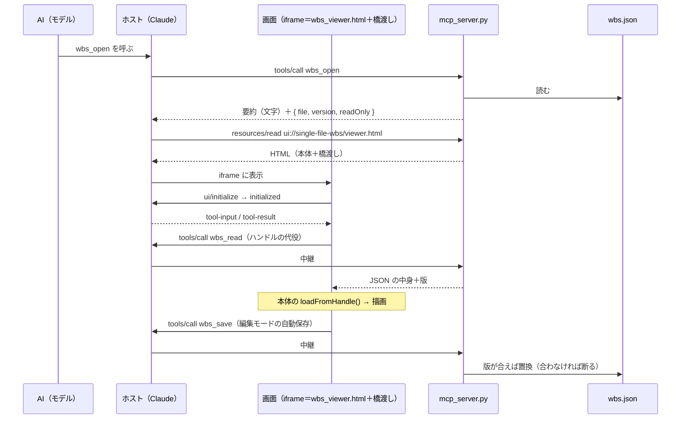

# MCP App 化の設計メモ（会話の中に WBS Viewer を出す）

`wbs_viewer.html` を無改変のまま、MCP Apps 対応ホスト（Claude など）の会話の中に表示・編集できるようにした構成の記録。

最終更新：2026-11-12（初版）

使い方は [`README.md`](../../README.md) の「Claude の中で開く」、AI 向けの作法は [`AGENTS.md`](../../AGENTS.md) の同名の節。判断の理由は [ADR-0012](../adr/0012-mcp-app-bridge-injection.md)。

---

## 構成

| パス | 役割 |
|---|---|
| `scripts/mcp_server.py` | MCP サーバー（Python 標準ライブラリだけ）。stdio と HTTP の2つの通信路。ツール3つと `ui://` の画面1つを出す |
| `scripts/mcp_app/bridge.js` | 橋渡し。サーバーが配る直前に `wbs_viewer.html` の `</body>` の手前へ差し込む（`scripts/build_demo.py` と同じ作法） |
| `tests/e2e_mcp/` | 回帰網。サーバー単体（`test_server.py`）と、ホスト役の iframe の中での往復（`test_app.py`） |

`wbs_viewer.html` は 1 バイトも変えていない（追記ブロックを除くとバイト一致することを `test_server.py` が確かめる）。

## データの流れ

- **モデルの文脈に流れるのは要約だけ**。JSON の中身（数百 KB になる）は画面が `wbs_read` で取りに行く。`wbs_read`／`wbs_save` は `_meta.ui.visibility: ["app"]` でモデルから隠す。
- **画面は生きている**。「更新」を押すとその時点のファイルを読み直す。会話を開き直した時も、古い写しではなく今のファイルが出る。

## 橋渡しがやること（5つだけ）

1. **ホストと話す**：JSON-RPC 2.0 over `postMessage`。MCP Apps 仕様 `2026-01-26` の `ui/initialize`／`ui/notifications/*`／`tools/call` を手書きで実装（SDK を使わない＝依存ゼロを保つ）。
2. **ファイルハンドルの代役**：本体の「ファイルを開く」は `showOpenFilePicker()` が返すハンドルを読む。その返事を、`getFile().text()`＝`wbs_read`／`createWritable().close()`＝`wbs_save` に読み替えた代役に差し替えてボタンを押す。**読込・編集・自動保存・保存状態の表示は本体のコードがそのまま動く**（e2e がフェイクハンドルを渡すのと同じ入口）。
3. **ダイアログの代役**：sandbox の iframe では `alert` は出ず、`confirm` は常に `false`、`prompt` は `null` になる。どれも同期の関数なので、画面内の帯で知らせて次の形にする。
   - `alert` → 帯に出す。
   - `confirm` → 1回目は帯に出して `false`。**10秒以内に同じ操作をもう一度**すると `true`。
   - `prompt` → 1回目は帯に入力欄を出して `null`。OK の後に**同じ操作をもう一度**すると、入力した値を返す。
4. **大きさと表示モード**：本体は画面いっぱいに敷くレイアウトなので、高さをホストが決めていない時は 640px を `ui/notifications/size-changed` で伝える。ホストが全画面に対応していれば、操作バーに「全画面」ボタンを足す（`ui/request-display-mode`）。
5. **外部リンク**：sandbox は新しいタブを開けないので、`http(s)` のリンクは `ui/open-link` でホストに開いてもらう。

ほかに、行へ飛ぶ時の `history.pushState` が iframe の中で拒まれても先へ進めるよう `try/catch` で包み、「ファイルを開く」ボタンを隠している（開くのはホスト側のツール）。

## 保存の守り

| 守り | 中身 |
|---|---|
| 外部変更を上書きしない | 版＝ファイルの中身の SHA-256（先頭16桁）。`wbs_save` は「読んだ時の版」と今のファイルが違えば断る。本体の更新時刻による検知は使わない（代役の `lastModified` は固定）。**断られた編集は画面に残り、本体が「保存失敗」を出す**。「更新」で読み直す |
| 半端なファイルを残さない | 同じフォルダの一時ファイルに書き切って `fsync` → `os.replace` で置換 |
| 壊れた JSON を書かない | `wbs_save` は JSON として読めない文字列を断る |
| 開ける範囲 | ファイルを指して起動＝そのファイルだけ。フォルダを指して起動＝その中の `.json` だけ（`..`・絶対パス・フォルダの外を指す symlink は断る） |
| HTTP の入口 | 合言葉（`--token`）なしでは、`Host` と `Origin` が自分の端末のものだけ受ける（DNS リバインディングと、開いている Web ページからの呼び出しを断る）。合言葉つきは URL が `/mcp/<合言葉>` になる |
| 閉じる前 | ホストの `ui/resource-teardown` を受けたら、書きかけの保存を流し切ってから返事をする |

## 確認済みの範囲（2026-11-12）

| 何を | どう確かめたか | 結果 |
|---|---|---|
| サーバーの宣言・読み書きの守り・stdio／HTTP | `tests/e2e_mcp/test_server.py` | 通過 |
| 画面の往復（表示・編集・保存・外部変更・ダイアログの代役・全画面・外部リンク・読み取り専用） | `tests/e2e_mcp/test_app.py`（テスト用の最小ホスト・sandbox 2通り・既定の CSP で違反0件） | 通過 |
| 公式の参照ホストでの動作 | ext-apps の `examples/basic-host` 2.1.0（公式の MCP クライアントと `AppBridge`・二重 iframe の sandbox proxy）に HTTP でつなぎ、headless Chromium で表示・編集保存・行へのジャンプ・削除の確認・全画面の往復を操作 | 通過（手動の1回きり。回帰網には入れていない） |
| **Claude Desktop／claude.ai の実機** | — | **未確認**。下の3点は実機で見る必要がある |

実機で見る点：

1. **ローカル（stdio）のサーバーで画面が出るか**、会話の中の高さ（640px の希望）がどう扱われるか。
2. **大きい JSON**（数百 KB）の `wbs_read`／`wbs_save` が、ホストのツール結果・引数の上限に掛からないか。
3. **`visibility: ["app"]`** のツールがモデルに見えていないこと（見えていても害は無いが、文脈を使う）。

## 既知の制限

- 確認の「同じ操作をもう一度」は、**文言が同じなら同じ確認とみなす**。文言に対象名が入らない確認（方針の ✕ など）は、10秒以内に別の行の ✕ を押しても確定する。
- 課題側のメタ行のファイル名が `—` になる（本体の課題側がファイル名を受け取っていないため。`file://` で開いた時も同じ）。
- ブラウザの中で動く MCP クライアント（参照ホストなど）から HTTP で直接つなぐには CORS が要る。サーバーは CORS ヘッダを返さない（Claude のコネクタはサーバー側からつなぐので不要）。
- 画面からファイルを選び直す UI は無い。別のファイルは、AI に `wbs_open` の `file` を変えて呼んでもらう。
- モデルが JSON を直すためのツール（`2.3 着手した` を1回の呼び出しで書く等）は、この版には入れていない。
